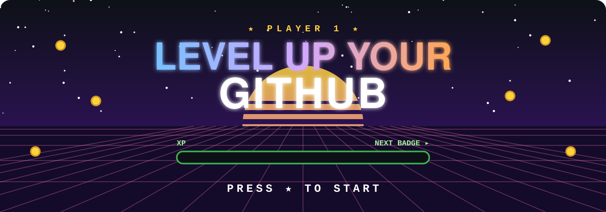
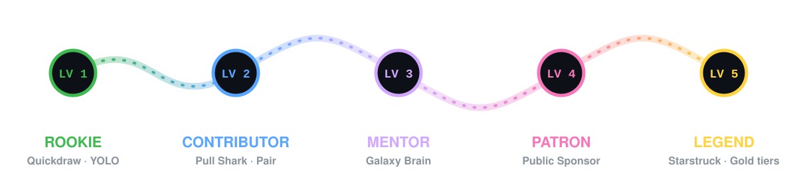

<div align="center">



### Your GitHub profile has a trophy case. 🏆<br>Most people leave it empty. Let's fill yours.

<a href="achievements/starstruck.md"></a>
<a href="achievements/pull-shark.md"></a>
<a href="achievements/pair-extraordinaire.md"></a>
<a href="achievements/galaxy-brain.md"></a>
<a href="achievements/quickdraw.md"></a>
<a href="achievements/yolo.md"></a>
<a href="achievements/public-sponsor.md"></a>


**[🗺️ Quest map](#️-the-quest-map) · [🃏 Badge cards](#-choose-your-quest) · [⚡ Speedrun](#-speedrun-4-badges-in-10-minutes) · [👹 Boss fights](#-boss-fights-going-for-gold) · [🏺 Relics](#-lost-relics) · [🔮 Secrets](#-secret-badges) · [✨ Rare drops](#-rare-drops-profile-highlights) · [📋 Tracker](TRACKER.md)**

</div>


## 🗺️ The quest map

Every GitHub user starts at **Level 1** with an empty trophy case. Here's the road from your first commit to legend status.



| Level | Title | Unlock | You'll learn |
|:-:|---|---|---|
| **1** | 🟢 Rookie | Quickdraw, YOLO | Issues, PRs, merging |
| **2** | 🔵 Contributor | Pull Shark, Pair Extraordinaire | Branches, pull requests, coauthoring |
| **3** | 🟣 Mentor | Galaxy Brain | Helping people in Discussions |
| **4** | 🩷 Patron | Public Sponsor | Supporting open source |
| **5** | 🟡 Legend | Starstruck + any Gold tier | Building things people love |


## 🃏 Choose your quest

Every card is a real badge GitHub puts on your profile. Click one for the full strategy guide.

> **Rarity:** 🟢 Common · 🔵 Rare · 🟣 Epic · 🟠 Legendary  ·  *XP is just for fun. GitHub doesn't count it, but you can.*

<table>
<tr>
<td align="center" width="25%" valign="top">
<a href="achievements/quickdraw.md"></a>
<h3>Quickdraw</h3>
🟢 <b>Common</b> · <code>+50 XP</code><br>
<sub>Close an issue or PR within <b>5 minutes</b> of opening it.</sub><br><br>
⏱️ <b>1 min</b>
</td>
<td align="center" width="25%" valign="top">
<a href="achievements/yolo.md"></a>
<h3>YOLO</h3>
🟢 <b>Common</b> · <code>+50 XP</code><br>
<sub>Merge a pull request <b>without a review</b>. Live dangerously.</sub><br><br>
⏱️ <b>3 min</b>
</td>
<td align="center" width="25%" valign="top">
<a href="achievements/pull-shark.md"></a>
<h3>Pull Shark</h3>
🟢 <b>Common</b> → 🟠 <b>Legendary</b> · <code>+100 XP/tier</code><br>
<sub>Get <b>2</b> pull requests merged.</sub><br>
<sub>🥉 16 · 🥈 128 · 🥇 1,024</sub><br>
⏱️ <b>5 min</b> to start
</td>
<td align="center" width="25%" valign="top">
<a href="achievements/pair-extraordinaire.md"></a>
<h3>Pair Extraordinaire</h3>
🟢 <b>Common</b> → 🟣 <b>Epic</b> · <code>+100 XP/tier</code><br>
<sub>Coauthor a commit in <b>1</b> merged PR.</sub><br>
<sub>🥉 10 · 🥈 24 · 🥇 48</sub><br>
⏱️ <b>5 min</b> to start
</td>
</tr>
<tr>
<td align="center" valign="top">
<a href="achievements/galaxy-brain.md"></a>
<h3>Galaxy Brain</h3>
🔵 <b>Rare</b> → 🟠 <b>Legendary</b> · <code>+200 XP/tier</code><br>
<sub>Get <b>2</b> answers accepted in Discussions.</sub><br>
<sub>🥉 8 · 🥈 16 · 🥇 32</sub><br>
⏱️ <b>A few days</b>
</td>
<td align="center" valign="top">
<a href="achievements/public-sponsor.md"></a>
<h3>Public Sponsor</h3>
🔵 <b>Rare</b> · <code>+150 XP</code><br>
<sub>Publicly sponsor a developer on <b>GitHub Sponsors</b>, from $1.</sub><br><br>
⏱️ <b>2 min</b>
</td>
<td align="center" valign="top">
<a href="achievements/starstruck.md"></a>
<h3>Starstruck</h3>
🟣 <b>Epic</b> → 🟠 <b>Legendary</b> · <code>+300 XP/tier</code><br>
<sub>A repo you own hits <b>16</b> stars.</sub><br>
<sub>🥉 128 · 🥈 512 · 🥇 4,096</sub><br>
⏱️ <b>Weeks to years</b>
</td>
<td align="center" valign="top">
<a href="TRACKER.md"></a>
<h3>Your trophy case</h3>
📋 <b>Track it all</b><br>
<sub>A copy-paste checklist for all 19 levels.</sub><br><br>
<a href="TRACKER.md"><b>Open tracker →</b></a>
</td>
</tr>
</table>


## ⚡ Speedrun: 4 badges in 10 minutes

> 🎯 **Category:** Any% · **Goal:** Quickdraw + YOLO + Pull Shark + Pair Extraordinaire · **Record to beat:** 10:00

All you need is the [GitHub CLI](https://cli.github.com) and a repo you own. Start the clock. ⏱️

<table>
<tr><td>

**🏁 00:00 · Spawn a playground**

```bash
gh repo create achievement-playground --public --clone --add-readme
cd achievement-playground
```

</td></tr>
<tr><td>

**⚡ 01:00 · Quickdraw.** Open an issue and close it straight away.

```bash
gh issue create --title "Quickdraw!" --body "Too fast"
gh issue close 1
```

✅  **Quickdraw unlocked**

</td></tr>
<tr><td>

**🤝 03:00 · Pair Extraordinaire + YOLO + Pull Shark (1/2)**

```bash
git switch -c pair-1
echo "We did it together" > pair.txt
git add pair.txt
git commit -m "Add pair.txt" -m "Co-authored-by: Octocat <583231+octocat@users.noreply.github.com>"
git push -u origin pair-1
gh pr create --fill
gh pr merge --merge --delete-branch
```

✅  **Pair Extraordinaire** ✅  **YOLO**

</td></tr>
<tr><td>

**🦈 07:00 · Pull Shark (2/2).** Merge one more PR.

```bash
git switch main && git pull
git switch -c pair-2
echo "Round two" >> pair.txt
git commit -am "Round two"
git push -u origin pair-2
gh pr create --fill
gh pr merge --merge --delete-branch
```

✅  **Pull Shark unlocked**

</td></tr>
<tr><td>

**🏆 10:00 · GG!** Open `https://github.com/<you>?tab=achievements` and admire your trophy case. New badges can take from a few minutes to a few hours to appear.

</td></tr>
</table>

> [!NOTE]
> **YOLO didn't drop?** Request a review from a collaborator on your next PR, then merge it before they respond. More in the [YOLO guide](achievements/yolo.md).


## 👹 Boss fights: going for Gold

Four badges level up. Each tier swaps in new artwork and adds an `x2`, `x3` or `x4` label. Here's what each level of Pull Shark looks like:

<div align="center">

|  |  |  |  |
|:-:|:-:|:-:|:-:|
| **Default** | **🥉 Bronze** `x2` | **🥈 Silver** `x3` | **🥇 Gold** `x4` |

</div>

<details>
<summary><b>🦈 Pull Shark Gold: 1,024 merged PRs</b> · <i>difficulty ★★★★☆</i></summary>
<br>


**Bosses:** 🥉 16 → 🥈 128 → 🥇 1,024 merged PRs

**Strategy:** ship small. One focused PR a day gets you to Silver in about four months. Fix docs, add tests, and bump dependencies in projects you use. Look for `good first issue` labels.

**Combo:** turn on squash merges so every small fix counts as its own PR.

[Full guide →](achievements/pull-shark.md)
<br clear="right">
</details>

<details>
<summary><b>🤝 Pair Extraordinaire Gold: 48 coauthored PRs</b> · <i>difficulty ★★☆☆☆</i></summary>
<br>


**Bosses:** 🥉 10 → 🥈 24 → 🥇 48 merged PRs with coauthored commits

**Strategy:** pair program with a friend every week. Add `Co-authored-by:` to the commits you write together, and you **both** level up.

**Combo:** when you squash-merge a PR that has several authors, GitHub adds the coauthor trailers for you.

[Full guide →](achievements/pair-extraordinaire.md)
<br clear="right">
</details>

<details>
<summary><b>🧠 Galaxy Brain Gold: 32 accepted answers</b> · <i>difficulty ★★★☆☆</i></summary>
<br>


**Bosses:** 🥉 8 → 🥈 16 → 🥇 32 accepted answers

**Strategy:** go to [GitHub Community Discussions](https://github.com/orgs/community/discussions), filter by **Unanswered**, and answer questions about tools you know well. Clear steps and a code block win.

**Combo:** a polite *"Did this fix it? Feel free to mark it as the answer!"* gets far more answers marked.

[Full guide →](achievements/galaxy-brain.md)
<br clear="right">
</details>

<details>
<summary><b>⭐ Starstruck Gold: 4,096 stars</b> · <i>difficulty ★★★★★, the final boss</i></summary>
<br>


**Bosses:** 🥉 128 → 🥈 512 → 🥇 4,096 stars on **one** repo you own

**Strategy:** build something small and genuinely useful, like a CLI tool, a template, a cheat sheet or an `awesome-` list. Give it a README with a GIF, and share it on Hacker News, Reddit and dev.to.

**Combo:** a repo like this one. *(Starring it helps us reach Starstruck too 😉)*

[Full guide →](achievements/starstruck.md)
<br clear="right">
</details>


## 🏺 Lost relics

Once-in-a-lifetime badges from past events. **They can't be earned anymore.** If you spot one on a profile, that developer was there.

<table>
<tr>
<td align="center" width="50%">
<a href="achievements/arctic-code-vault-contributor.md"></a>
<h3>❄️ Arctic Code Vault Contributor</h3>
<sub>Your code is buried <b>250 m deep in Arctic permafrost</b> in Svalbard, on film built to last 1,000 years. Awarded for contributing to repos in the 2020 GitHub Archive snapshot.</sub>
</td>
<td align="center" width="50%">
<a href="achievements/mars-2020-contributor.md"></a>
<h3>🚁 Mars 2020 Helicopter Contributor</h3>
<sub>Your code <b>flew on Mars</b>. Awarded to about 12,000 developers whose open source commits were used by NASA's Ingenuity helicopter.</sub>
</td>
</tr>
</table>

## 🔮 Secret badges

Found in GitHub's code but never released. 👀 Nobody outside GitHub knows when, or whether, they'll drop.

<table>
<tr>
<td align="center" width="50%">
<a href="achievements/unreleased.md#heart-on-your-sleeve"></a><br>
<b>Heart On Your Sleeve</b><br><sub>Rumor: react with ❤️</sub>
</td>
<td align="center" width="50%">
<a href="achievements/unreleased.md#open-sourcerer"></a><br>
<b>Open Sourcerer</b><br><sub>Rumor: contribute across many open source repos</sub>
</td>
</tr>
</table>


## ✨ Rare drops: profile highlights

These aren't achievements. They're special tags in the **Highlights** part of your sidebar, earned from programs and roles. GitHub draws them with its own [Octicons](https://primer.style/octicons), shown here as-is. [Details →](achievements/highlights.md)

<table>
<tr>
<td align="center" width="14%"><br><b>PRO</b><br><sub>Pro plan or Student Pack</sub></td>
<td align="center" width="14%"><br><b>Developer Program</b><br><sub>Build on GitHub's API</sub></td>
<td align="center" width="14%"><br><b>Bug Bounty Hunter</b><br><sub>Find a bug in GitHub itself</sub></td>
<td align="center" width="14%"><br><b>Advisory Credit</b><br><sub>Get credited on a CVE advisory</sub></td>
<td align="center" width="14%"><br><b>Campus Expert</b><br><sub>Lead your campus community</sub></td>
<td align="center" width="14%"><br><b>GitHub Star</b><br><sub>Be nominated as a top community leader</sub></td>
<td align="center" width="14%"><br><b>Staff</b><br><sub>Work at GitHub</sub></td>
</tr>
</table>


## 🎒 Daily quests

Small habits that level you up while you build real skills:

- [ ] 🌱 **Commit something** every day, even a README tweak, and watch your contribution graph go green
- [ ] 🔀 **Open one PR** per day instead of pushing straight to `main` (Pull Shark 🦈)
- [ ] 🤝 **Pair with a friend** once a week and add `Co-authored-by:` (Pair Extraordinaire)
- [ ] 💬 **Answer one question** a week in [Community Discussions](https://github.com/orgs/community/discussions) (Galaxy Brain 🧠)
- [ ] 🐛 **Fix one `good first issue`** a month in a project you use
- [ ] 💖 **Sponsor one maintainer** whose code you depend on (Public Sponsor)
- [ ] 🚀 **Ship one side project** with a great README (Starstruck ⭐)

## 🖼️ Show off your trophy case

Got some badges? Paste this into your [profile README](https://docs.github.com/en/account-and-profile/setting-up-and-managing-your-github-profile/customizing-your-profile/managing-your-profile-readme) and delete the ones you haven't earned yet:

```html
<h3>🏆 My GitHub Achievements</h3>


```

Swap `-default` for `-bronze`, `-silver` or `-gold` as you level up.

> [!IMPORTANT]
> **🛡️ Play fair.** Badges are a fun side effect of real work. Mass-producing spam PRs, buying stars, or flooding other people's repos breaks GitHub's [Acceptable Use Policies](https://docs.github.com/en/site-policy/acceptable-use-policies/github-acceptable-use-policies) and can get your account flagged. Farm your own playground, help real projects, and the badges will come.


<div align="center">

## 🌟 Join the party

**Earned a badge thanks to this guide? [Drop a ⭐](https://github.com/abdullah-al-faahim/github-achievements/stargazers)** so we can reach Starstruck together.<br>
Found a new badge or a changed threshold? **[Open a PR](CONTRIBUTING.md)**. It counts toward your Pull Shark 🦈

[📋 Tracker](TRACKER.md) · [❓ FAQ](FAQ.md) · [🤝 Contributing](CONTRIBUTING.md)
</div>

<details>
<summary><b>🛠️ Under the hood</b></summary>
<br>

```
.
├── README.md                    ← you are here
├── TRACKER.md                   ← copy-paste progress checklist
├── FAQ.md                       ← delays, private repos, hiding badges
├── achievements/                ← one strategy guide per badge
├── assets/
│   ├── hero.svg, quest-map.svg, divider.svg, tier-legend.svg   ← animated art
│   └── highlights/              ← official Octicons used for profile highlights
├── data/achievements.json       ← names, tiers, thresholds, badge URL
└── scripts/generate_badges.py   ← rebuilds the art and lists every badge URL
```

Badge images are GitHub's official artwork, loaded straight from `github.githubassets.com` (the same files your profile uses). Run `python scripts/generate_badges.py` to rebuild the animated SVGs and print every badge URL for checking.

</details>

<div align="center">
<br>
<sub>
Fan-made guide. Not affiliated with or endorsed by GitHub, Inc.
Achievement badge images are © GitHub, Inc., linked from GitHub's own servers and not redistributed.
Octicons are © GitHub, Inc. under the MIT License. Thresholds are community-verified and may change.
</sub>
</div>
