<div align="center">

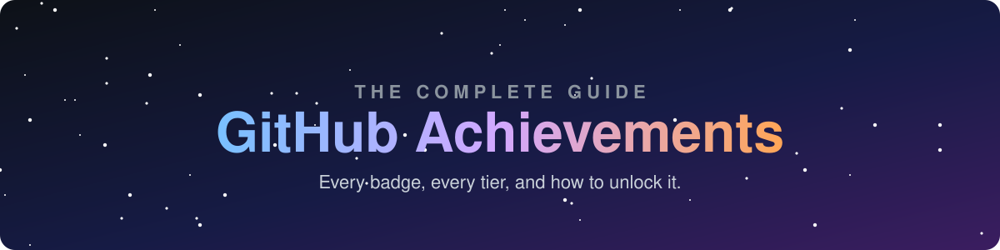

<br>


**A field guide to every achievement and badge that can appear on a GitHub profile:
what each one means, how to earn it, and what it takes to reach every tier.**

[Achievements](#-active-achievements) ·
[Tiers](#-how-tiers-work) ·
[Retired](#-retired-achievements) ·
[Unreleased](#-unreleased-achievements) ·
[Highlights](#-profile-highlights) ·
[Tracker](TRACKER.md) ·
[FAQ](FAQ.md)

</div>

---

## 🏆 Active achievements

These are the achievements any GitHub user can earn today. Click a badge for the full guide.

<table>
<tr>
<td align="center" width="25%">
<a href="achievements/starstruck.md"></a><br>
<b>Starstruck</b><br>
<sub>A repo you own reaches <b>16</b> stars</sub><br>
<sub>🥉 128 · 🥈 512 · 🥇 4096</sub>
</td>
<td align="center" width="25%">
<a href="achievements/pull-shark.md">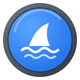</a><br>
<b>Pull Shark</b><br>
<sub><b>2</b> of your pull requests are merged</sub><br>
<sub>🥉 16 · 🥈 128 · 🥇 1024</sub>
</td>
<td align="center" width="25%">
<a href="achievements/pair-extraordinaire.md"></a><br>
<b>Pair Extraordinaire</b><br>
<sub>Coauthor a commit in <b>1</b> merged PR</sub><br>
<sub>🥉 10 · 🥈 24 · 🥇 48</sub>
</td>
<td align="center" width="25%">
<a href="achievements/galaxy-brain.md">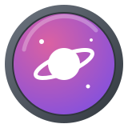</a><br>
<b>Galaxy Brain</b><br>
<sub><b>2</b> accepted answers in Discussions</sub><br>
<sub>🥉 8 · 🥈 16 · 🥇 32</sub>
</td>
</tr>
<tr>
<td align="center">
<a href="achievements/quickdraw.md">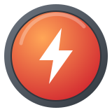</a><br>
<b>Quickdraw</b><br>
<sub>Close an issue or PR within <b>5 minutes</b> of opening it</sub><br>
<sub>Single tier</sub>
</td>
<td align="center">
<a href="achievements/yolo.md">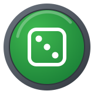</a><br>
<b>YOLO</b><br>
<sub>Merge a pull request <b>without a review</b></sub><br>
<sub>Single tier</sub>
</td>
<td align="center">
<a href="achievements/public-sponsor.md"></a><br>
<b>Public Sponsor</b><br>
<sub>Sponsor someone through <b>GitHub Sponsors</b></sub><br>
<sub>Single tier</sub>
</td>
<td align="center">
<a href="TRACKER.md">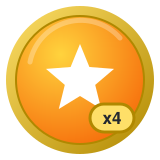</a><br>
<b>Your progress</b><br>
<sub>Copy the checklist and tick off<br>every badge you've unlocked</sub><br>
<sub><a href="TRACKER.md">Open tracker →</a></sub>
</td>
</tr>
</table>

### At a glance

| | Achievement | How to earn it | Default | 🥉 Bronze | 🥈 Silver | 🥇 Gold | Effort |
|:-:|---|---|:-:|:-:|:-:|:-:|:-:|
|  | [Starstruck](achievements/starstruck.md) | Stars on a single repo you own | 16 | 128 | 512 | 4,096 | ⭐⭐⭐ |
|  | [Pull Shark](achievements/pull-shark.md) | Merged pull requests you opened | 2 | 16 | 128 | 1,024 | ⭐ |
|  | [Pair Extraordinaire](achievements/pair-extraordinaire.md) | Merged PRs with a commit you coauthored | 1 | 10 | 24 | 48 | ⭐ |
|  | [Galaxy Brain](achievements/galaxy-brain.md) | Accepted answers in Discussions | 2 | 8 | 16 | 32 | ⭐⭐ |
|  | [Quickdraw](achievements/quickdraw.md) | Close an issue/PR within 5 min | 1 | – | – | – | ⭐ |
|  | [YOLO](achievements/yolo.md) | Merge a PR without a review | 1 | – | – | – | ⭐ |
|  | [Public Sponsor](achievements/public-sponsor.md) | Sponsor via GitHub Sponsors | 1 | – | – | – | ⭐⭐ |

> [!TIP]
> Quickdraw, YOLO and Pull Shark can all be earned in about ten minutes on a repository of your own. Pair Extraordinaire takes one more step: add a `Co-authored-by:` trailer to a commit. The [quick-start guide](#-quick-start-four-badges-in-ten-minutes) below walks through it.

---

## 🎚 How tiers work

<div align="center">
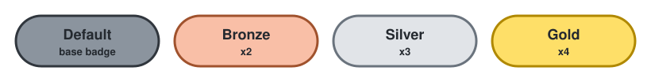
</div>

Four achievements level up as you keep going. Each new tier changes the badge's **ring color** and adds a **multiplier label** (`x2`, `x3`, `x4`) in the corner. Your profile only shows the highest tier you've reached.

| Tier | Label | Starstruck | Pull Shark | Pair Extraordinaire | Galaxy Brain |
|---|:-:|:-:|:-:|:-:|:-:|
| Default | – | 16 | 2 | 1 | 2 |
| 🥉 Bronze | `x2` | 128 | 16 | 10 | 8 |
| 🥈 Silver | `x3` | 512 | 128 | 24 | 16 |
| 🥇 Gold | `x4` | 4,096 | 1,024 | 48 | 32 |

<details>
<summary><b>See every tier of each badge</b></summary>
<br>

**Starstruck**<br>
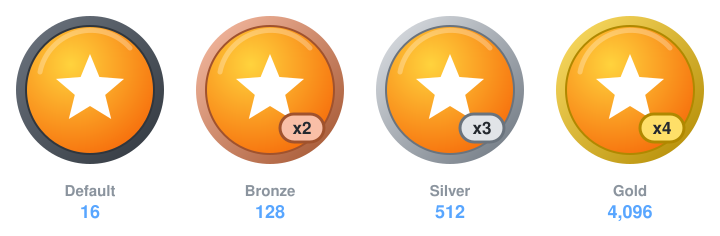

**Pull Shark**<br>
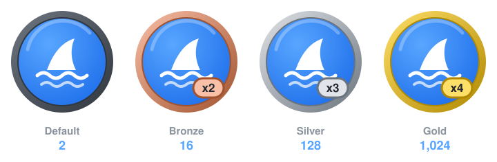

**Pair Extraordinaire**<br>
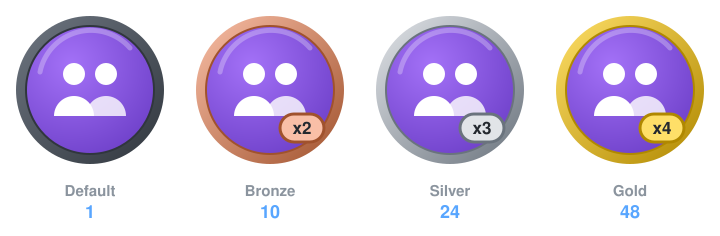

**Galaxy Brain**<br>
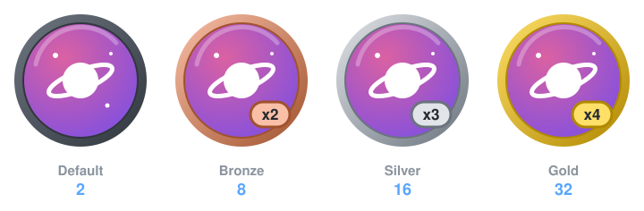

</details>

---

## 🧊 Retired achievements

These were awarded for one-time events. **They can no longer be earned**, but people who got them keep them.

| | Achievement | What it was for | Window |
|:-:|---|---|---|
|  | [Arctic Code Vault Contributor](achievements/arctic-code-vault-contributor.md) | Code in active public repos captured by the **2020 GitHub Archive Program** snapshot, stored in the Arctic World Archive in Svalbard | Snapshot taken 2 Feb 2020 |
|  | [Mars 2020 Helicopter Contributor](achievements/mars-2020-contributor.md) | Commits to open source projects used by NASA's **Ingenuity** Mars helicopter | Awarded April 2021 |

---

## 🔮 Unreleased achievements

These have shown up in GitHub's front-end code and in testing, but GitHub has never officially awarded them to the public. Treat everything about them as **unconfirmed**.

| | Name | What people think it's for |
|:-:|---|---|
|  | [Heart On Your Sleeve](achievements/unreleased.md#heart-on-your-sleeve) | Reacting to something on GitHub with ❤️ |
| 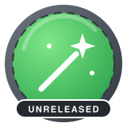 | [Open Sourcerer](achievements/unreleased.md#open-sourcerer) | Contributing to many open source repositories |

---

## ✨ Profile highlights

Highlights aren't achievements. They're badges in the **Highlights** section of your profile sidebar, and they come from programs, plans, or roles. Full details are in [highlights.md](achievements/highlights.md).

<table>
<tr>
<td align="center" width="14%"><br><b>PRO</b><br><sub>GitHub Pro plan</sub></td>
<td align="center" width="14%">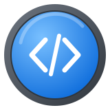<br><b>Developer Program</b><br><sub>Joined the program</sub></td>
<td align="center" width="14%">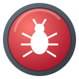<br><b>Bug Bounty Hunter</b><br><sub>Valid report to GitHub's bounty</sub></td>
<td align="center" width="14%"><br><b>Advisory Credit</b><br><sub>Credited on a reviewed advisory</sub></td>
<td align="center" width="14%"><br><b>Campus Expert</b><br><sub>Student leader program</sub></td>
<td align="center" width="14%"><br><b>GitHub Star</b><br><sub>Nominated community leader</sub></td>
<td align="center" width="14%"><br><b>Staff</b><br><sub>GitHub employee</sub></td>
</tr>
</table>

---

## ⚡ Quick start: four badges in ten minutes

You need one repository you own. A throwaway one is fine.

```bash
# 0. Create a playground repo and clone it
gh repo create achievement-playground --public --clone --add-readme
cd achievement-playground
```

**1. Quickdraw** (close something within 5 minutes)

```bash
gh issue create --title "Quickdraw" --body "Closing right away"
gh issue close 1
```

**2. Pair Extraordinaire + YOLO + Pull Shark (1 of 2)**

```bash
git switch -c pair-1
echo "hello" > pair.txt
git add pair.txt
git commit -m "Add pair.txt" -m "Co-authored-by: Octocat <583231+octocat@users.noreply.github.com>"
git push -u origin pair-1
gh pr create --fill
gh pr merge --merge --delete-branch   # no review requested → YOLO
```

> [!NOTE]
> Strictly speaking, YOLO is awarded when you merge a PR on which a review was **requested** but never given. If merging without any reviewer doesn't unlock it, request a review from a collaborator, then merge before they respond.

**3. Pull Shark (2 of 2)**: repeat step 2 on a new branch (`pair-2`). That's two merged PRs.

Badges usually show up within a few minutes, though sometimes it takes a few hours. Use the coauthor email from the person's GitHub *noreply* address (Settings → Emails) so the commit links to their account.

> [!IMPORTANT]
> Use this to learn the workflow, not to spam. Mass-generating PRs or stars to farm achievements, especially on other people's repositories, can break GitHub's [Acceptable Use Policies](https://docs.github.com/en/site-policy/acceptable-use-policies/github-acceptable-use-policies).

---

## 🗂 Repository layout

```
.
├── README.md                ← you are here
├── TRACKER.md               ← copyable progress checklist
├── FAQ.md                   ← visibility, delays, private repos, hiding badges
├── achievements/            ← one detailed guide per achievement
├── assets/
│   ├── badges/              ← every badge at every tier
│   ├── tiers/               ← side-by-side tier strips
│   ├── highlights/          ← profile highlight badges
│   ├── banner.svg
│   └── tier-legend.svg
├── data/achievements.json   ← single source of truth (names, tiers, colors)
└── scripts/generate_badges.py  ← regenerates all artwork from the JSON
```

Change a threshold or color in `data/achievements.json`, then run `python scripts/generate_badges.py` to regenerate the artwork.

## 🤝 Contributing

GitHub changes achievements without announcing it. If you spot a new badge, a changed threshold, or a mistake, open an issue or a PR. See [CONTRIBUTING.md](CONTRIBUTING.md).

---

<div align="center">
<sub>
This is a fan-made reference and isn't affiliated with or endorsed by GitHub, Inc.
The badge artwork here is original. "GitHub" and the achievement names belong to GitHub, Inc.
Thresholds are community-verified and may change.
</sub>
</div>
