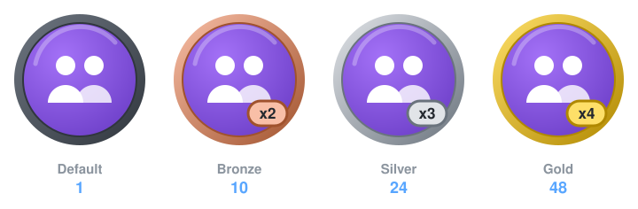

<div align="center">


# Pair Extraordinaire

*Coauthored commits on merged pull requests.*



</div>

| | |
|---|---|
| **Status** | ✅ Active |
| **Tiers** | Default 1 · 🥉 Bronze 10 · 🥈 Silver 24 · 🥇 Gold 48 |
| **What counts** | Merged PRs containing a commit with a `Co-authored-by:` trailer |
| **Effort** | ⭐ Easy |

## How it works

GitHub reads `Co-authored-by:` trailers in commit messages. When a pull request that contains such a commit is merged, **everyone named in the commit** (the author and each coauthor) gets credit toward this badge.

| Tier | Merged PRs with coauthored commits | Label |
|---|:-:|:-:|
| Default | 1 | – |
| Bronze | 10 | `x2` |
| Silver | 24 | `x3` |
| Gold | 48 | `x4` |

## How to earn it

### 1. Get your partner's commit email

Use the email linked to their GitHub account. The privacy-friendly *noreply* address works best:

```
ID+username@users.noreply.github.com
```

You can find any user's ID with `gh api users/<username> --jq .id`.

### 2. Add the trailer

Leave **a blank line** after the commit body, then add one trailer per coauthor:

```bash
git commit -m "Add search feature" -m "Co-authored-by: Jane Doe <12345+janedoe@users.noreply.github.com>"
```

or in your editor:

```
Add search feature

Co-authored-by: Jane Doe <12345+janedoe@users.noreply.github.com>
Co-authored-by: Sam Lee <67890+samlee@users.noreply.github.com>
```

### 3. Open a PR and get it merged

Both of you get credit once it's merged.

## Good to know

- When you **squash-merge** a PR on GitHub with several authors' commits, GitHub adds `Co-authored-by` trailers automatically.
- VS Code Live Share, GitHub Desktop and many IDEs have a "coauthor" field that writes the trailer for you.
- The email must match a verified email on the coauthor's account, or the commit won't link to them.

<div align="center">

[← Back to all achievements](../README.md)

</div>
