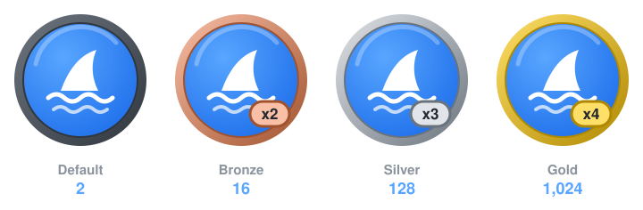

<div align="center">


# Pull Shark

*Opened pull requests that have been merged.*



</div>

| | |
|---|---|
| **Status** | ✅ Active |
| **Tiers** | Default 2 · 🥉 Bronze 16 · 🥈 Silver 128 · 🥇 Gold 1,024 |
| **What counts** | Pull requests **you opened** that got **merged** |
| **Effort** | ⭐ Easy to start, a long grind to Gold |

## How it works

Each pull request you author counts once it's merged into its target branch. Merging into your own repository counts as well as merging into someone else's.

| Tier | Merged PRs | Label |
|---|:-:|:-:|
| Default | 2 | – |
| Bronze | 16 | `x2` |
| Silver | 128 | `x3` |
| Gold | 1,024 | `x4` |

## How to earn it

**On your own repo (fastest)**

```bash
git switch -c docs-typo
# make any change
git commit -am "Fix typo in README"
git push -u origin docs-typo
gh pr create --fill
gh pr merge --squash --delete-branch
```

Do that twice and you have the default badge.

**In open source (most meaningful)**

1. Look for issues labelled `good first issue` or `help wanted`, or browse [github.com/topics/hacktoberfest](https://github.com/topics/hacktoberfest).
2. Fork, branch, fix, and open a PR that links the issue (`Fixes #123`).
3. Keep each PR small and focused, and follow the project's `CONTRIBUTING.md`.

## Good to know

- **Closed** (unmerged) PRs don't count.
- Squash, rebase and regular merges all count.
- PRs in **private** repos count only if you've enabled *Include private contributions* in your profile settings.
- Opening hundreds of empty PRs on your own repo technically works, but the badge loses its meaning and it can look like spam.

<div align="center">

[← Back to all achievements](../README.md)

</div>
