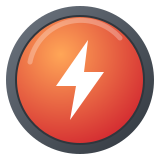

<div align="center">



# Quickdraw

*Closed an issue or pull request within 5 minutes of opening it.*

</div>

| | |
|---|---|
| **Status** | ✅ Active |
| **Tiers** | Single tier |
| **What counts** | An issue or PR closed **≤ 5 minutes** after it was opened |
| **Effort** | ⭐ About a minute |

## How to earn it

### In the browser

1. Open any repository you own → **Issues** → **New issue**.
2. Give it a title and click **Submit new issue**.
3. Click **Close issue** right away.

### With the GitHub CLI

```bash
gh issue create --title "Quickdraw" --body "test" --repo <you>/<repo>
gh issue close <number> --repo <you>/<repo>
```

## Good to know

- Pull requests count too. Opening a PR and closing it without merging within 5 minutes works.
- Closing a duplicate or mistaken issue right after you file it also counts, which is how most people get this badge without trying.
- Closing as "not planned" or "completed" both count.

<div align="center">

[← Back to all achievements](../README.md)

</div>
